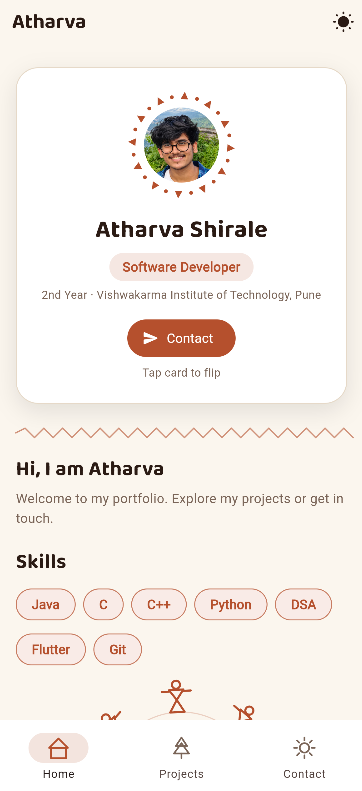
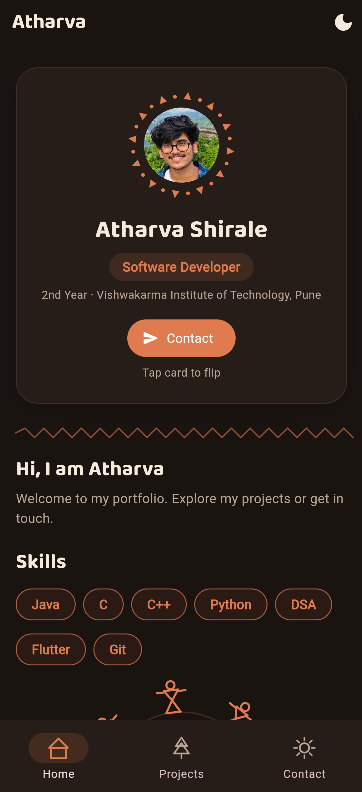
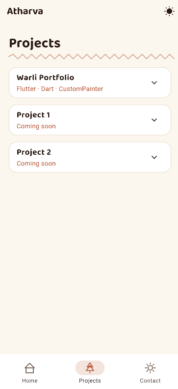
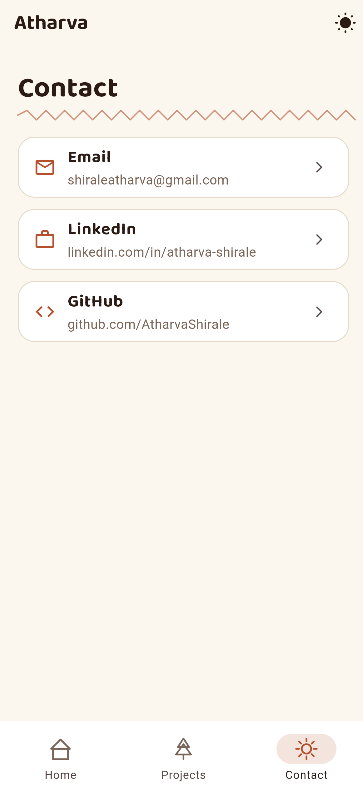
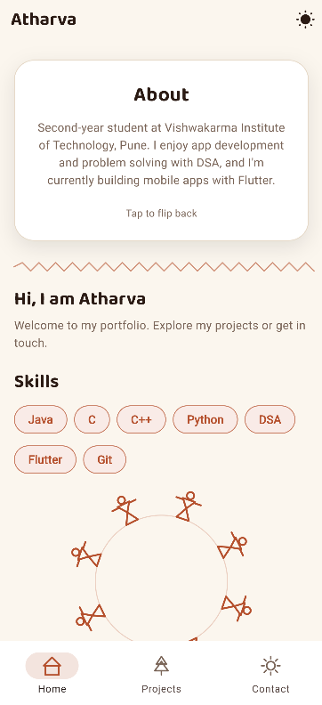

# Warli Portfolio

A personal portfolio Flutter web app inspired by the Warli art tradition of Maharashtra. Features custom-painted animations, a flip profile card, light/dark theme toggle, and a clean project showcase.

## Features

- Warli-art custom painters (splash, tarpa dance, decorative ring)
- Flip profile card with animated Warli ring
- Light/dark theme toggle with ValueNotifier
- Responsive layout for web
- Accessible (Semantics labels, 48x48 tap targets, reduced-motion support)
- Organized code with models/data/theme/painters/widgets/screens

## Tech Stack

- Flutter 3.13+
- Dart
- CustomPainter
- url_launcher
- google_fonts

## Folder Structure

```
lib/
├── models/
│   └── project.dart          # Project data model
├── data/
│   └── profile_data.dart      # All personal / profile info
├── theme/
│   └── theme.dart             # Light & dark themes, Palette, heading()
├── painters/
│   └── warli_painters.dart    # CustomPainter classes & WarliIcon
├── widgets/
│   ├── profile_card.dart      # Flip card with avatar ring
│   ├── contact_sheet.dart     # Bottom-sheet contact options
│   └── skill_chips.dart       # Skills Wrap chips
├── screens/
│   ├── splash_screen.dart     # Animated splash
│   ├── app_shell.dart         # Scaffold + NavigationBar
│   ├── home_screen.dart       # Home tab
│   ├── projects_screen.dart   # Projects list
│   └── contact_screen.dart    # Contact list
└── main.dart                  # App entry point
```

## How to Run

```bash
flutter pub get
flutter run -d chrome
```

## Screenshots







---

Inspired by Warli art of Maharashtra
